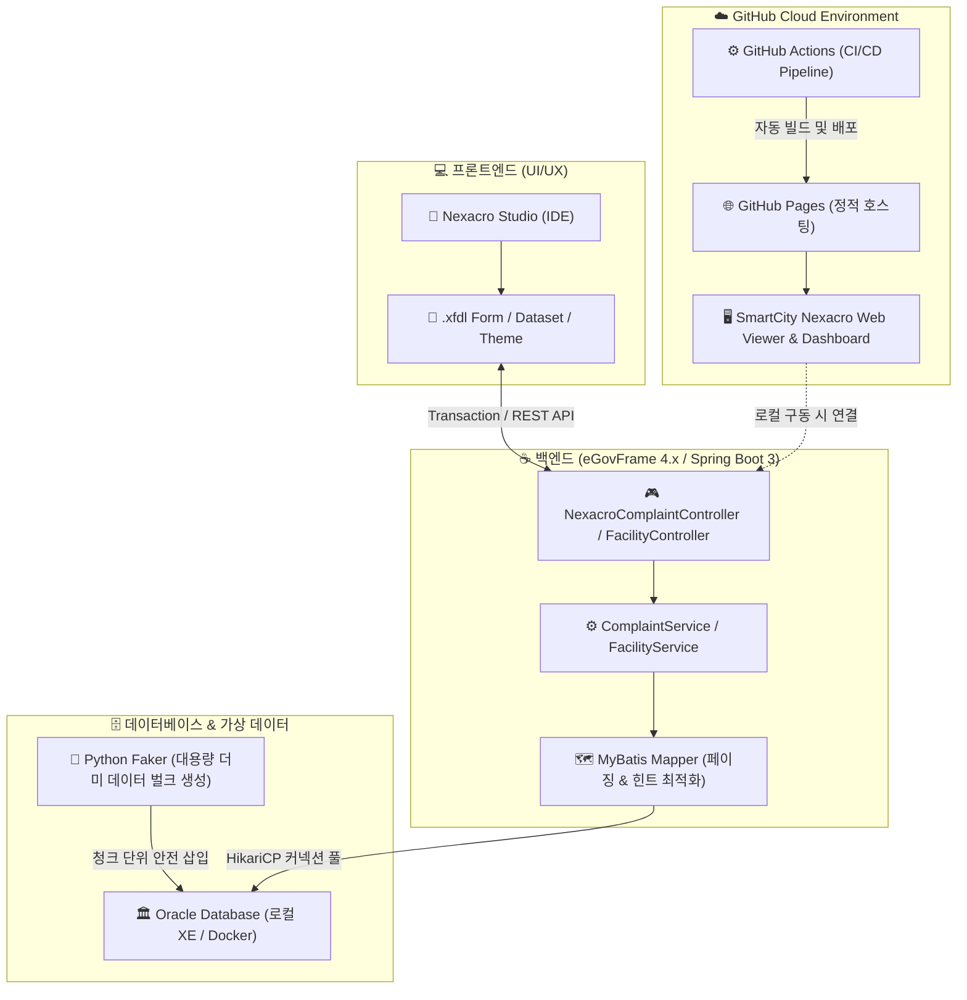

AI - egovoframework - nexacro automation system


# 스마트시티 공공시설 & 시민 민원 통합관제 시스템
> **eGovFrame 4.x(전자정부프레임워크) & Nexacro N & Oracle DB & GitHub Actions 자동 배포**

[](https://github.com/srunaic/Integrated_learning_materials/actions/workflows/deploy.yml)
[](https://opensource.org/licenses/MIT)
[](https://spring.io/)
[](https://www.oracle.com/java/)
[](http://support.tobesoft.co.kr)
[](https://www.oracle.com/database/)

---


## 🌐 1. 온라인 라이브 데모 (GitHub Pages)

GitHub Actions를 통해 본 저장소의 정적 웹 포털이 GitHub Pages로 자동 배포됩니다.  
별도의 설치 없이 브라우저에서 즉시 스마트시티 관제 대시보드 및 넥사크로 UI를 체험할 수 있습니다:

🔗 **https://integrated-learning-materials.victoryka123.workers.dev/**

---


## 🏗️ 2. 시스템 아키텍처 (System Architecture)



---

## ✨ 3. 핵심 기능 소개

1. **📊 스마트시티 종합 관제 대시보드**:
   - 가로등, 방범 CCTV, 스마트 쉘터, 전기차 급속충전기, 배수펌프의 가동률 실시간 모니터링
   - 관할 자치구별(강남, 서초, 송파, 마포, 영등포 등) 시설물 구축 현황 시각화 (Chart.js)
   - 민원 처리 단계(접수 -> 배정 -> 처리중 -> 완료 -> 반려) 비율 분석
2. **📋 넥사크로 시민 통합 민원 관리 (Civil Complaint Management)**:
   - 대한민국 공공 표준 **Nexacro Grid & Dataset 바인딩** UI 구조 재현
   - 대용량 데이터 시 PC 버벅임을 차단하는 **Offset-Fetch 기반 페이징** (1페이지 20건 분할)
   - 행(Row) 클릭 시 우측 전용 상세 폼으로 단방향/양방향 실시간 동기화
   - 현장 조치 담당자 배정 및 시민 회신 답변 등록 트랜잭션
   - 엑셀(CSV) 원클릭 대용량 내보내기 지원
3. **🏢 공공 시설물 자산 & 점검 이력 (Master-Detail)**:
   - 시설물 마스터 선택 시 하단에 점검/유지보수 이력이 즉시 연동되는 마스터-디테일 관계
4. **📡 IoT 센서 실시간 텔레메트리 (Time-Series)**:
   - 도심 시설물에 부착된 온습도, 진동(g), 전력량(kWh), 미세먼지 수치 실시간 계측 로그

---

## 📁 4. 프로젝트 디렉토리 구조

```
egovoframework_nexacro/
├── .github/
│   └── workflows/
│       └── deploy.yml              # GitHub Pages 자동 배포 GitHub Actions 워크플로우
├── backend/                        # 전자정부프레임워크(eGovFrame 4.x) 백엔드
│   ├── src/main/java/...           # Spring Boot 컨트롤러, 모델, 매퍼
│   ├── src/main/resources/         # application.yml, MyBatis XML 매퍼
│   ├── build.gradle                # 의존성 및 오라클 JDBC 드라이버 설정
│   └── egovframe_setup_guide.md    # 백엔드 설치 및 실행 가이드
├── nexacro/                        # 투비소프트 넥사크로(Nexacro N) 소스
│   ├── Application_Desktop.xadl    # 애플리케이션 시작 정의
│   ├── Environment.xml             # 넥사크로 런타임 환경 설정
│   ├── TypeDefinition.xml          # 컴포넌트 모듈 정의
│   ├── project/form/               # .xfdl 화면 폼 (민원관리, 시설물관리)
│   └── nexacro_beginner_guide.md   # 초보자를 위한 넥사크로 10분 입문 매뉴얼
├── db/                             # 오라클 DB & Python Faker
│   ├── schema_oracle.sql           # 오라클 DDL (인덱스 최적화 및 시퀀스)
│   ├── generate_dummy.py           # 메모리 절약형 대용량 더미 데이터 생성기
│   ├── dummy_data_insert.sql       # 생성된 2.5MB 대량 데이터 INSERT 스크립트
│   └── db_optimization_guide.md    # PC 버벅임 방지 오라클 메모리 튜닝 가이드
├── web_portal/                     # GitHub Pages 배포용 정적 웹 포털
│   ├── index.html                  # 스마트시티 통합 관제 메인
│   ├── css/style.css               # 하이테크 다크모드 & 넥사크로 그리드 CSS
│   ├── js/app.js                   # 넥사크로 에뮬레이션 엔진 & Chart.js
│   └── mock_data/                  # 온라인 데모용 JSON Mock 데이터
└── README.md
```

---

## ⚡ 5. 대용량 데이터 관리 & PC 버벅임 방지 가이드

많은 데이터가 쌓였을 때 PC가 느려지는 현상을 방지하기 위해 다음 3대 최적화가 적용되어 있습니다:

1. **Python Faker 메모리 보호 (`db/generate_dummy.py`)**:
   - 대량 데이터를 한 번에 메모리에 올리지 않고 1,000건 단위 청크(Chunk)로 나누어 처리
   - `python db/generate_dummy.py --facilities 120 --complaints 1500 --sensors 4000`
2. **Oracle 메모리(SGA/PGA) 제한 설정 (`db/db_optimization_guide.md`)**:
   - 오라클 XE의 메모리 점유율을 1.5GB 이내로 제한하여 백그라운드 RAM 고갈 방지
3. **DB 인덱스 & 페이징 필수 적용 (`db/schema_oracle.sql`)**:
   - `TB_CIVIL_COMPLAINT`의 `REG_DATE DESC`, `STATUS`에 B-Tree 복합 인덱스 생성
   - 백엔드 쿼리에 `OFFSET #{offset} ROWS FETCH NEXT #{pageSize} ROWS ONLY` 적용

---

## 🚀 6. 로컬 구동 방법

### 1단계: 더미 데이터 생성 및 DB 적용
```bash
# 1. 파이썬 의존성 설치
pip install faker oracledb

# 2. 더미 데이터 생성 (SQL 파일 및 mock_data 동시 생성)
python db/generate_dummy.py
```

### 2단계: 백엔드 서버 구동
```bash
cd backend
gradle bootRun
# 포트 8080에서 서버가 실행됩니다.
```

### 3단계: 웹 관제 포털 확인
- 브라우저에서 `web_portal/index.html`을 바로 열거나 Live Server를 실행합니다.
- GitHub에 커밋 & 푸시하면 cloudflare 서버 에 의해 자동으로 배포됩니다!
